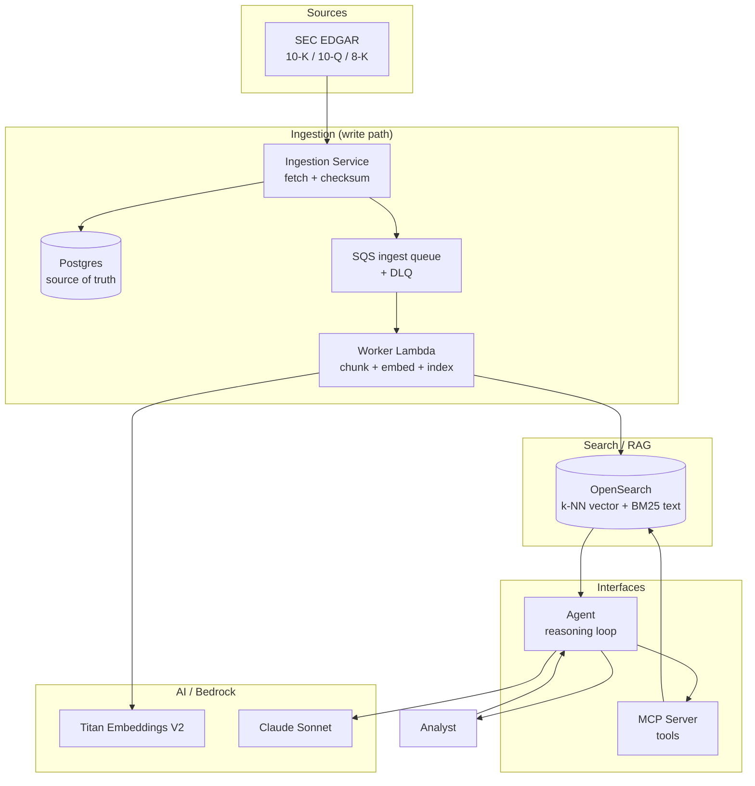
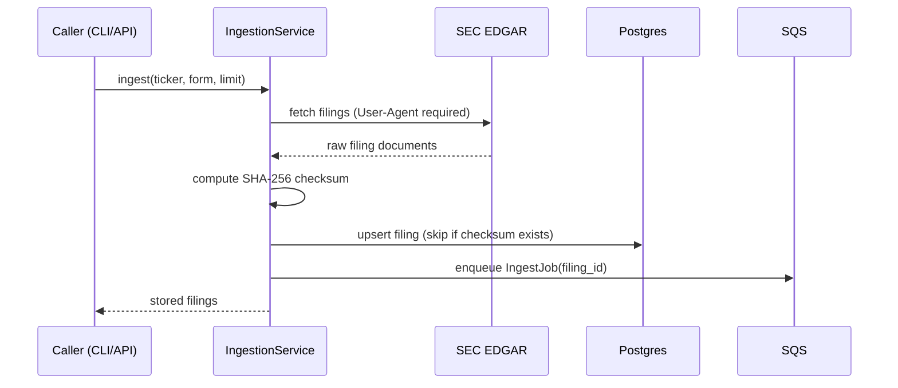
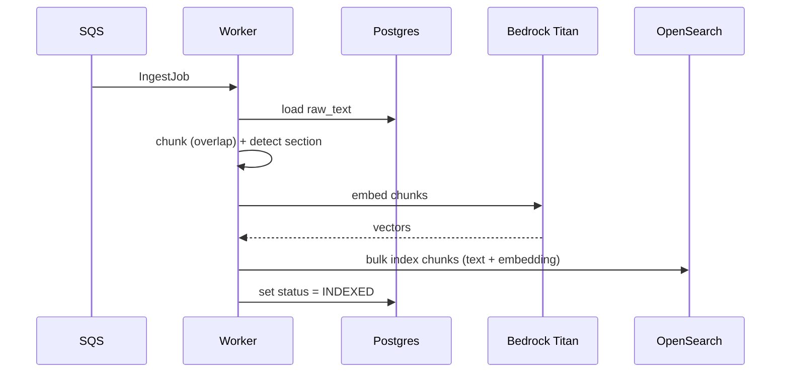
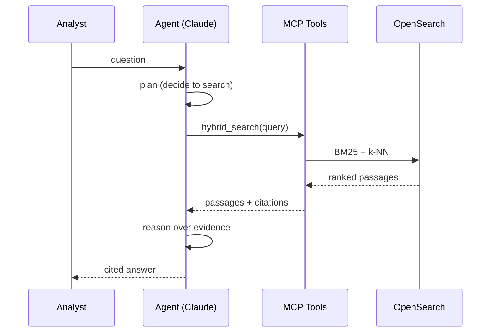

# Architecture

This document describes the high-level (HLD) and low-level (LLD) design of the
Filings Assistant.

## System overview

The system has two data flows — an **ingestion (write) path** and a **query
(read) path** — sharing one search index and one source-of-truth database.



## Ingestion (write path)



Key properties:
- **Idempotent** — a unique constraint on the content checksum means re-ingesting
  the same filing is a no-op (no duplicate indexing).
- **Decoupled** — ingestion returns fast; the slow embed/index work is async.

## Worker (async indexing)



On repeated failure, SQS routes the message to the **dead-letter queue** after
`maxReceiveCount` (5) attempts, so a poison filing can't block the pipeline.

## Query (read path) — Agentic RAG



## Ranking funnel: retrieve → fuse → rerank

Hybrid search is a three-stage funnel (`search/service.py`):

```
Stage 1 RETRIEVE   OpenSearch BM25 + kNN (over-fetch ~50 candidates)
Stage 2 FUSE       Reciprocal Rank Fusion (combine the two rankings)
Stage 3 RERANK     SageMaker cross-encoder re-scores the shortlist → top k
```

**Fusion (RRF)** combines the two *rankings* (not raw scores, which are on
different scales):

```
RRF(d) = Σ  1 / (k + rank_d)      across both result lists (k = 60)
```

**Rerank** re-scores each `(query, passage)` pair jointly with a cross-encoder
for precision the first stage can't reach. It runs only on the shortlist, so
it's cheap. Backends: SageMaker endpoint (AWS) or a local lexical cross-scorer
(offline). See `docs/SEARCH_EXCELLENCE.md`.

## Multi-tenancy

Every layer is isolated by `tenant_id` (sourced from auth, never from the
prompt). OpenSearch uses a per-tenant index + tenant filter; Postgres uses a
`tenant_id` column + Row-Level Security; tools/agent are bound to one tenant and
expose no tenant argument. See `docs/MULTI_TENANCY.md`.

## Components

| Component | Module | Responsibility |
|---|---|---|
| Config | `common/config.py` | Env-driven settings, run modes |
| Bedrock client | `common/bedrock.py` | Titan embed + Claude converse (+ mock) |
| Storage | `common/storage.py` | Postgres repo + SQS queue (+ in-memory) |
| Models | `models/filing.py` | Filing, Chunk, SearchHit, IngestJob |
| SEC client | `ingestion/sec_client.py` | EDGAR fetch (+ offline samples) |
| Ingestion | `ingestion/service.py` | fetch → store → enqueue |
| Worker | `worker/processor.py` | chunk → embed → index |
| Tenant context | `common/tenant.py` | immutable per-request tenant scope |
| Chunker | `search/chunker.py` | overlapping windows + section detect |
| Vector store | `search/opensearch_store.py` | per-tenant index mapping + queries (+ in-memory) |
| Reranker | `search/reranker.py` | SageMaker cross-encoder (+ local fallback) |
| Search | `search/service.py` | tenant-scoped funnel: retrieve → RRF → rerank |
| Query understanding | `agent/query_understanding.py` | rewrite + extract metadata filters |
| Evaluation | `evaluation/` | Recall@k, MRR, nDCG + rerank comparison |
| Tools | `mcp_server/tools.py` | tenant-bound tool registry + schemas |
| MCP server | `mcp_server/server.py` | expose tools over MCP stdio |
| Agent | `agent/agent.py` | tenant-scoped, bounded tool-use reasoning loop |

## Local vs AWS parity

Every external dependency has a local implementation selected by config, so the
same application code runs offline (in-memory + mock Bedrock) or on AWS (RDS,
SQS, OpenSearch Service, Bedrock) by changing env vars — no code branches in
business logic.

| Dependency | Local | AWS |
|---|---|---|
| Embeddings / LLM | Mock (hash vectors, templated answers) | Bedrock (Titan, Claude) |
| Vector store | In-memory brute-force | OpenSearch Service (per-tenant index) |
| Reranker | Local lexical cross-scorer | SageMaker cross-encoder endpoint |
| Source of truth | In-memory dict | RDS Postgres (RLS) |
| Queue | In-memory deque | SQS (+ DLQ) |
```
