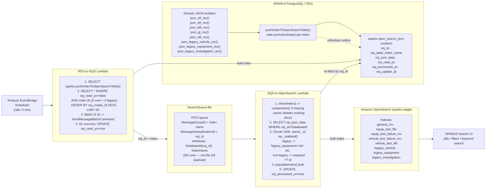
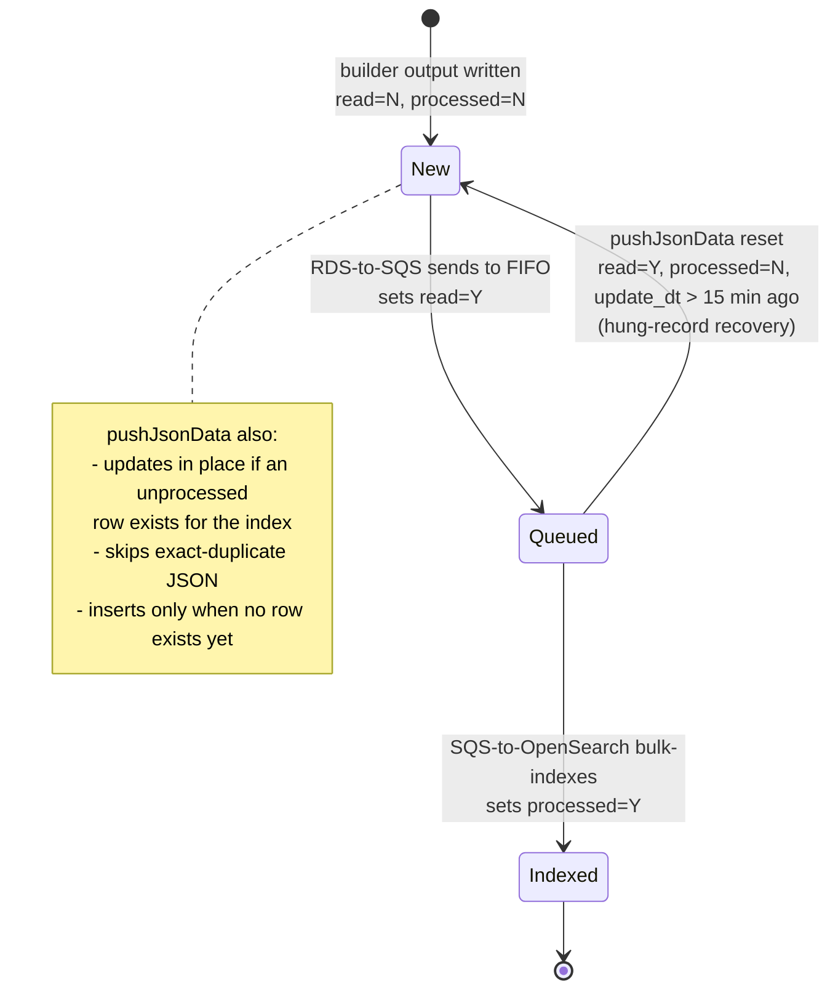

# SPARKS Current OpenSearch Indexing — As-Is (grounded in actual code)

This is the existing pipeline. **Nothing here changes** in Option 1 or Option 2.
The names, batch sizes, and flags below are taken directly from the Lambda handlers
and the `sparks.pushjsondata` / `sparks.pushindextoopensearchtable` PL/pgSQL functions.

## Row lifecycle (from `pushJsonData` + both Lambdas)

## Notes that matter for the AI design
- `osj_json_data` is a **denormalized document array** — already the right shape for AI retrieval / search content.
- Every doc carries `uniqueId` (e.g. `legacy_equipment:12251`); the consumer stamps the OpenSearch `_id` from it. This is a ready-made citation key.
- The outbox (`sparks.open_search_json`) is the natural, read-only tap point for AI search content — no operational tables are touched.
