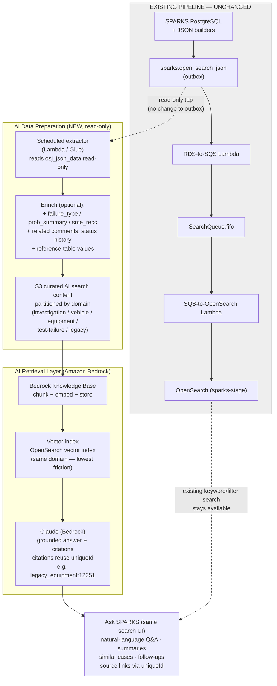

# Option 1 — RAG / "Ask SPARKS" (Future / To-Be)

Keeps the **entire current pipeline unchanged** (greyed box). Adds a separate,
read-only AI path that taps the **same `sparks.open_search_json` outbox** the
current consumer already reads — so the AI search content reuses the exact
denormalized documents (and their `uniqueId` citation keys) that OpenSearch
indexes today.

### Why this answers "why two searches?"
One UI, two retrieval capabilities. Exact/filtered lookups keep using the current
OpenSearch index; natural-language/semantic requests use the RAG path. The AI path
**reads the same outbox** rather than duplicating or modifying the operational search,
so there is no second user-facing search and no change to the indexing pipeline.
