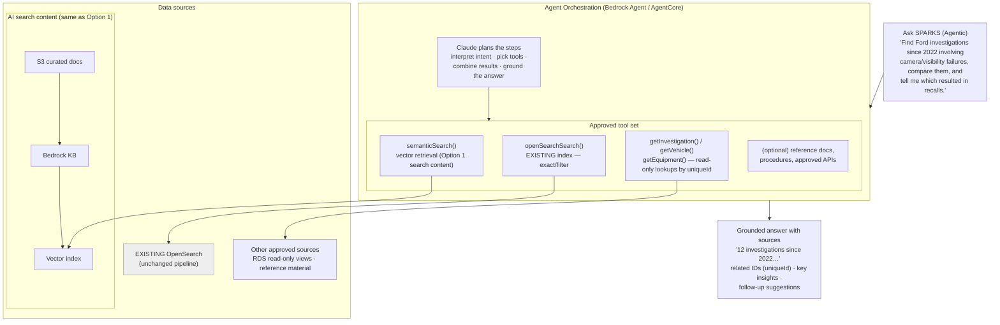

# Option 2 — Agentic Hybrid Search (Future / To-Be)

Everything in Option 1, plus an agent that decides **which approved tool** to call.
Crucially, the agent's "keyword/filter" tool is the **existing OpenSearch index** —
the current pipeline is reused as one tool, not rebuilt.

### Option 1 vs Option 2 in one line
- **Option 1 (RAG):** we enrich the search content *ahead of time*; Claude answers from retrieval.
- **Option 2 (Agentic):** the agent can *also* call approved live tools (incl. the current
  OpenSearch) when the search content doesn't fully cover the question — multi-step reasoning.
